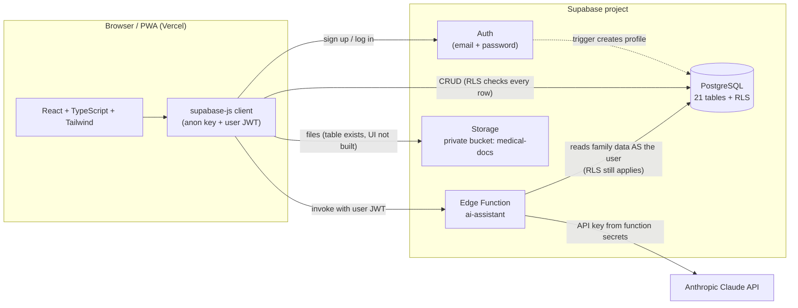
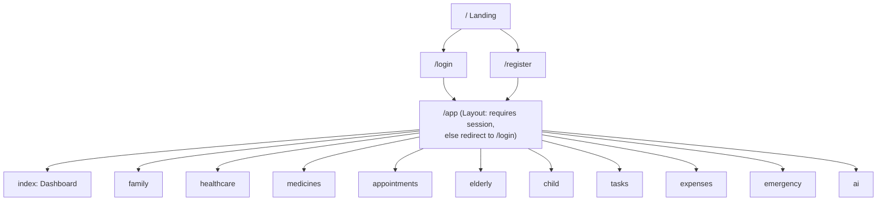
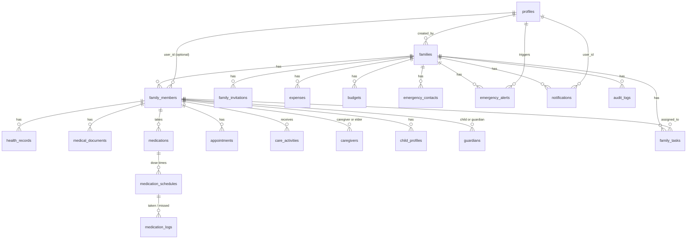
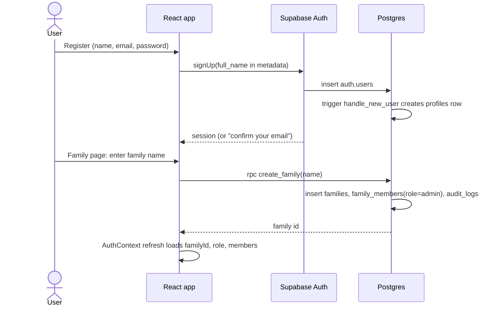
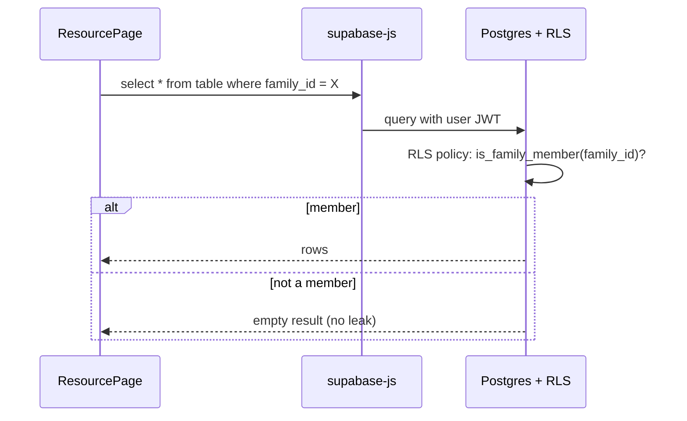
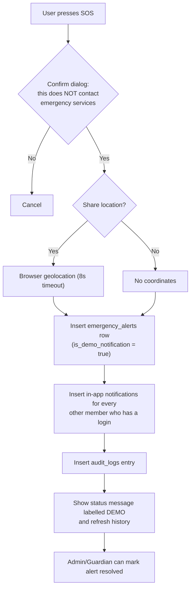
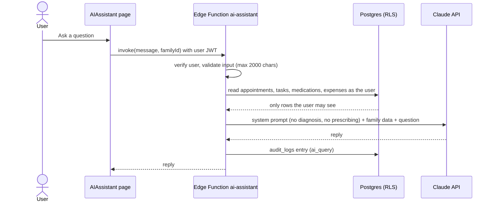

# The Family Care Hub

> One Family. One Platform. Complete Care.

A family management platform for healthcare, elderly care, child safety, medicine reminders, appointments, tasks, expenses, emergencies, and an AI assistant. Built as a React web app (with a PWA manifest) on top of Supabase.

> **Honest status:** the code was written without being installed, compiled, or run (package installs were blocked in the build environment), and it has never been tested against a live Supabase project. Expect small compile fixes on first run. See [Status and limitations](#10-status-and-limitations).

---

## Table of contents

1. [What it is](#1-what-it-is)
2. [Architecture](#2-architecture)
3. [Project structure](#3-project-structure)
4. [Database design](#4-database-design)
5. [Security model (roles and RLS)](#5-security-model-roles-and-rls)
6. [Key flows](#6-key-flows)
7. [Feature to code to table map](#7-feature-to-code-to-table-map)
8. [Setup and running](#8-setup-and-running)
9. [Testing checklist](#9-testing-checklist)
10. [Status and limitations](#10-status-and-limitations)
11. [Troubleshooting](#11-troubleshooting)

---

## 1. What it is

A family signs up, one person creates the family and becomes its **admin**, and everyone in that family shares one private workspace:

- **Family** – members, roles, invitations (recorded only).
- **Healthcare** – blood group and history notes per member.
- **Medicines** – medicines per member (dose schedule tables exist; tracking UI not built).
- **Appointments** – doctor, hospital, time, status.
- **Elderly care** – check-ins and care activities.
- **Child safety** – school and activity schedules.
- **Tasks** – assign, set deadlines, update status.
- **Expenses** – income/expenses by category, monthly chart.
- **Emergency SOS** – alerts family members (demo notifications only).
- **AI assistant** – Claude answers questions about the family's own data. It does not diagnose or prescribe.

---

## 2. Architecture

The browser talks directly to Supabase. Security is enforced **in the database** (Row Level Security), not only in the UI. The Claude API key lives only inside an Edge Function and is never sent to the browser.



**Why this design**

| Decision | Reason |
|---|---|
| Browser talks straight to Supabase | No custom backend to build in a 48-hour hackathon. |
| Authorization in Postgres RLS | A UI bug cannot leak another family's data; the database refuses the query. |
| AI via Edge Function | The Anthropic key stays secret. |
| Edge Function uses the caller's JWT | The AI can only see what that user could already see. |
| `SECURITY DEFINER` helper functions | Avoid infinite recursion when RLS policies need to look up `family_members`. |

---

## 3. Project structure

```
family-care-hub/
├── index.html                      # Vite entry, links PWA manifest
├── package.json                    # React, Router, Recharts, Lucide, supabase-js, Tailwind
├── vite.config.ts / tsconfig.json / tailwind.config.js / postcss.config.js
├── .env.example                    # variables you must provide
├── public/manifest.webmanifest     # PWA manifest (no service worker/icons yet)
├── src/
│   ├── main.tsx                    # React root
│   ├── App.tsx                     # routes
│   ├── index.css                   # Tailwind + shared classes (.card .btn .input)
│   ├── lib/
│   │   ├── supabase.ts             # Supabase client
│   │   └── AuthContext.tsx         # session, familyId, role, members
│   ├── components/
│   │   ├── Layout.tsx              # protected shell: sidebar (desktop) + bottom bar (mobile)
│   │   └── ResourcePage.tsx        # reusable list + add form + delete + status
│   └── pages/
│       ├── Landing.tsx
│       ├── AuthPages.tsx           # Login, Register, password reset
│       ├── Dashboard.tsx           # live counts, chart, notifications
│       ├── Family.tsx              # create family, add member, invite
│       ├── modules.tsx             # Healthcare, Medicines, Appointments, Elderly, Child, Tasks, Expenses
│       ├── Emergency.tsx           # SOS button + history
│       └── AIAssistant.tsx         # chat UI
└── supabase/
    ├── migrations/001_schema.sql   # tables, indexes, RLS, functions, storage policies
    ├── seed_demo.sql               # fictional "[DEMO]" family
    └── functions/ai-assistant/index.ts   # server-side Claude call
```

**Frontend route map**



**The `ResourcePage` pattern.** Healthcare, Medicines, Appointments, Elderly, Child, Tasks and Expenses are all one reusable component configured with a table name, form fields, and display columns. It loads rows for the current family, inserts new rows (also writing an audit log entry), deletes rows, and optionally updates a status column. Adding a module means adding one small config, not a new page.

---

## 4. Database design

All 21 tables live in `supabase/migrations/001_schema.sql`. Almost every table carries `family_id`, which is what RLS keys on.



**Important modelling detail:** a `family_members` row is a *person in the family*. `user_id` is nullable, so you can record a grandmother or a child who never logs in. Only members with a `user_id` can sign in, receive notifications, or trigger SOS.

**Table groups**

| Group | Tables |
|---|---|
| Identity and membership | `profiles`, `families`, `family_members`, `family_invitations` |
| Health | `health_records`, `medical_documents`, `medications`, `medication_schedules`, `medication_logs` |
| Care | `appointments`, `caregivers`, `care_activities`, `child_profiles`, `guardians` |
| Household | `family_tasks`, `expenses`, `budgets` |
| Safety and system | `emergency_contacts`, `emergency_alerts`, `notifications`, `audit_logs` |

**Notable constraints:** blood group limited to the 8 valid types, medication `end_date >= start_date`, expense `amount > 0`, status columns restricted by `CHECK`, `unique (schedule_id, scheduled_date)` on dose logs, and a unique budget per family, month and category.

**Database functions**

| Function | Purpose |
|---|---|
| `handle_new_user()` (trigger on `auth.users`) | Creates a `profiles` row on signup. |
| `create_family(name)` | Creates the family, makes the caller its `admin`, and writes an audit log, all in one transaction. |
| `is_family_member(fid)` | True if the current user belongs to that family. |
| `family_role_of(fid)` | The current user's role in that family. |
| `is_family_manager(fid)` | True if that role is `admin` or `guardian`. |

---

## 5. Security model (roles and RLS)

Every table has Row Level Security enabled. A user only ever sees rows whose `family_id` belongs to a family they are a member of, so one family cannot read another's data.

Roles: `admin` (Family Admin), `guardian` (Parent / Guardian), `adult`, `elderly`, `caregiver`.

**What each role can do, as enforced by the policies in the migration**

| Data | Read | Write |
|---|---|---|
| Family info | Any member | Admin (update) |
| Family members | Any member | Admin, Guardian |
| Invitations | Admin, Guardian | Admin, Guardian |
| Health records, medical documents, medications | Any member | Admin, Guardian, Adult, Caregiver (**elderly are read-only**) |
| Caregivers, child profiles, guardians | Any member | Admin, Guardian |
| Medication schedules and logs, appointments, care activities, tasks, expenses, budgets, emergency contacts, notifications | Any member | Any member |
| Emergency alerts | Any member | Any member can create (as themselves); Admin/Guardian can resolve |
| Audit logs | Admin, Guardian | Any member inserts their own entries |
| Medical files (Storage) | Any member of that family | Admin, Guardian, Adult, Caregiver |

**Storage path convention:** `medical-docs/<family_id>/<member_id>/<file>`. The Storage policy reads the first folder segment as the family id, so a user cannot read or upload into another family's folder.

**Defence in depth:** the UI also hides add/invite forms from non-managers (Family page), but the real protection is the database. Other pages do not yet hide buttons by role; the database simply rejects disallowed writes and the page shows the error.

---

## 6. Key flows

### 6.1 Sign up and family creation



If email confirmation is enabled in your Supabase project, the user must confirm before logging in.

### 6.2 Page load with row-level checks



### 6.3 Emergency SOS



**This is a demo notification system.** No SMS, push, email or phone call is sent, and no emergency service is contacted. Real delivery would need an SMS/push provider called from an Edge Function.

### 6.4 AI assistant



The model name defaults to `claude-sonnet-5-5` and can be overridden with a `CLAUDE_MODEL` function secret. The assistant only receives appointments, tasks, medications and expenses. It does **not** yet read health records or uploaded documents, so the "explain medical reports" capability is not implemented.

---

## 7. Feature to code to table map

| Feature | Page / code | Tables | Status |
|---|---|---|---|
| Sign up, login, reset | `AuthPages.tsx` | `auth.users`, `profiles` | Built |
| Protected routes | `Layout.tsx` | – | Built |
| Create family | `Family.tsx` + `create_family()` | `families`, `family_members` | Built |
| Add members | `Family.tsx` | `family_members` | Built (no editing yet) |
| Invitations | `Family.tsx` | `family_invitations` | Recorded only |
| Healthcare | `modules.tsx` | `health_records` | Blood group + history; allergies/conditions columns exist, no input yet |
| Medicines | `modules.tsx` | `medications` | Add/list/delete; schedules and logs not in UI |
| Appointments | `modules.tsx` | `appointments` | List with status update; no calendar view |
| Elderly care | `modules.tsx` | `care_activities` | Check-ins and activities |
| Child safety | `modules.tsx` | `child_profiles` | Schedules |
| Tasks | `modules.tsx` | `family_tasks` | Create, assign, status |
| Expenses | `modules.tsx`, `Dashboard.tsx` | `expenses` | Income/expense; monthly category chart |
| Dashboard | `Dashboard.tsx` | several | Live counts |
| SOS | `Emergency.tsx` | `emergency_alerts`, `notifications` | Demo notifications |
| AI assistant | `AIAssistant.tsx` + Edge Function | reads 4 tables | Built, untested |
| Audit logging | `ResourcePage`, `Emergency`, Edge Function, `create_family` | `audit_logs` | Partial |

---

## 8. Setup and running

**Prerequisites:** Node 18+, a Supabase account, an Anthropic API key, and the [Supabase CLI](https://supabase.com/docs/guides/cli) for deploying the function.

1. **Install dependencies**
   ```bash
   npm install
   ```
2. **Create a Supabase project**, then copy `.env.example` to `.env` and fill in:
   ```
   VITE_SUPABASE_URL=https://YOUR-PROJECT.supabase.co
   VITE_SUPABASE_ANON_KEY=your-anon-key
   ```
   The anon key is safe in the browser because RLS protects the data. Never put the service-role key or the Anthropic key in a `VITE_` variable.
3. **Create the schema.** Paste `supabase/migrations/001_schema.sql` into the Supabase SQL editor and run it (or use `supabase db push`). Run it once on a fresh project.
4. **Deploy the AI function**
   ```bash
   supabase login
   supabase link --project-ref YOUR-PROJECT-REF
   supabase secrets set ANTHROPIC_API_KEY=your-claude-api-key
   supabase functions deploy ai-assistant
   ```
5. **Run the app**
   ```bash
   npm run dev
   ```
6. **Sign up** through the app. Then optionally load demo data: put your signup email in `supabase/seed_demo.sql` (replace `YOUR_EMAIL_HERE`) and run it in the SQL editor. It creates a fictional `[DEMO] Sharma Family` with an administrator, two adults, an elderly member, a caregiver, and sample health records, a medicine, an appointment, tasks, expenses and a budget. All names are clearly marked and no real patient data is used.
   > The seed creates a second family for your account. The app loads the first family it finds for you, so use a fresh account for the demo if you have already made a family.
7. **Deploy the frontend to Vercel:** import the repo, add `VITE_SUPABASE_URL` and `VITE_SUPABASE_ANON_KEY` as environment variables, and set the build command to `npm run build`. Single-page-app routes (`/app/...`) need a rewrite to `index.html` (add a `vercel.json` with a catch-all rewrite).

**Environment variables**

| Variable | Where | Secret? |
|---|---|---|
| `VITE_SUPABASE_URL` | Frontend `.env` / Vercel | No |
| `VITE_SUPABASE_ANON_KEY` | Frontend `.env` / Vercel | No (protected by RLS) |
| `ANTHROPIC_API_KEY` | Supabase function secret only | **Yes** |
| `CLAUDE_MODEL` | Supabase function secret (optional) | No |

---

## 9. Testing checklist

Run these by hand once the app is running, using two separate accounts to check isolation:

1. Register, then log in and out.
2. Create a family; confirm you appear as `admin`.
3. Add a member and a caregiver; refresh and confirm they persist.
4. Add a health record, a medicine, an appointment, a task and an expense; check the Dashboard counts and chart update.
5. Change a task status and an appointment status.
6. Add an elderly check-in.
7. Trigger SOS; confirm an alert row and notifications for other logged-in members, and that the message says DEMO.
8. Ask the AI assistant for a schedule summary and an expense summary.
9. **Permission tests:** log in as a second user in a different family and confirm none of the first family's rows appear; log in as an `elderly` user and confirm writes to health data are rejected; confirm a non-manager cannot add members.

None of these have been run yet.

---

## 10. Status and limitations

**Implemented (database-backed):** auth, family creation, members, healthcare notes, medicines, appointments, elderly check-ins, child profiles, tasks, expenses, SOS, dashboard, AI assistant.

**Not built or simulated**
- **SOS** notifications are an in-app demo only. No SMS, push, or emergency services.
- **Invitations** are stored but no email is sent and there is no accept flow.
- **Members cannot be linked to a login** except the family creator, because invitations are not acceptable yet.
- **File uploads:** the table and private bucket exist; there is no upload UI.
- **Dose tracking:** `medication_schedules` and `medication_logs` have no UI, so the dashboard's "pending doses today" is only non-zero for seeded data.
- **Not built:** budget alerts and monthly reports, missed check-in alerts, notification panel, calendar view, user settings/profile page, editing records, allergies/conditions/vaccination inputs.
- **Medicine and check-in reminders** are not delivered anywhere.
- **PWA** is manifest-only (no service worker, offline support, or icons).
- **UI role handling** is limited to the Family page; elsewhere the database rejects disallowed actions.
- **Security review:** RLS policies are written but unreviewed and untested. Do not use with real medical data until they are.

---

## 11. Troubleshooting

| Symptom | Likely cause |
|---|---|
| Page shows "Set VITE_SUPABASE_URL..." | `.env` missing or dev server not restarted after editing it. |
| Sign-up works but login fails | Email confirmation is on; confirm the email or disable it in Supabase Auth settings for testing. |
| "new row violates row-level security policy" | Your role is not allowed to write that table (see the table in section 5), or you have no family yet. |
| Lists are empty after adding data | You are a member of a different family than the data's `family_id` (common after running the seed on a used account). |
| AI says it is unavailable | Function not deployed, `ANTHROPIC_API_KEY` not set, or the model name is invalid; check the Edge Function logs. |
| TypeScript errors on first build | Expected on never-compiled code; fix and rebuild. |
| Deep links such as `/app/family` 404 on Vercel | Add an SPA rewrite to `index.html`. |
